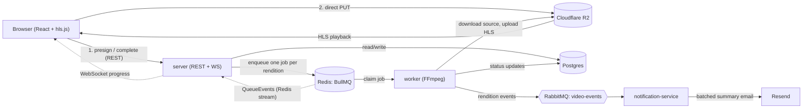

# StreamForge

**A distributed, YouTube-style video transcoding platform** — upload a video, it's automatically transcoded into multiple HLS renditions in parallel across a worker fleet, with live progress over WebSockets and email notifications on completion.

🔗 **Live demo:** [streamforge.ayushrana.me](https://streamforge.ayushrana.me)

> The demo runs on free-tier infrastructure. The backend sleeps when idle, so the first request after a quiet period can be slow. On the deployed demo, WebSockets are switched off and the UI polls for status instead of showing a live percentage bar; the full WebSocket path runs locally (see [`docs/ARCHITECTURE.md` §11](docs/ARCHITECTURE.md)).

Built to be architecturally honest: every service, queue, and trade-off exists for a stated reason — see [`docs/ARCHITECTURE.md`](docs/ARCHITECTURE.md) for the full reasoning behind every major decision.

---

## Features

- 🔐 **Auth** — JWT in an httpOnly cookie, bcrypt password hashing, `zod`-validated requests, rate-limited auth routes
- ☁️ **Direct-to-storage uploads** — presigned R2 URLs, so video bytes never transit the API server
- ⚙️ **Distributed transcoding** — BullMQ + Redis job queue, one job per output rendition, processed in parallel by independently scalable workers, FFmpeg-driven HLS output
- 📡 **Live progress** — hand-rolled WebSocket layer relaying real FFmpeg progress from `worker` to the browser (local/Docker; polling fallback on the free-tier demo)
- 📬 **Event-driven notifications** — RabbitMQ events, batched (one email per video, not per rendition) via Resend
- ▶️ **Adaptive playback** — `hls.js`-powered player with automatic bitrate switching
- 🔁 **Self-healing** — a periodic reconciliation sweep catches uploads that never completed their handshake
- ✅ **Tested** — integration tests against real (isolated) Postgres/Redis, not mocks
- 📈 **Load-tested** — worker concurrency and FFmpeg thread usage tuned from measured data (see [Performance](#performance))

---

## Architecture



Four independently deployable services — `server`, `worker`, `notification-service`, `frontend` — connected by a durable queue (BullMQ/Redis) for job dispatch and a message broker (RabbitMQ) for cross-service events, so the CPU-heavy transcoding path is fully decoupled from the request/response API path.

> **Note on the live demo's deployment topology:** for cost reasons (Render's free tier has no background-worker service type), `server` + `worker` + `notification-service` are bundled into a single container in production. The architecture above — genuinely separate, independently scalable services — is what `docker-compose.yml` runs locally, and is the real design. See [`docs/ARCHITECTURE.md` §12](docs/ARCHITECTURE.md) for the full reasoning.

---

## Performance

Load-tested locally with Docker Compose: 6 uploads (12 transcode jobs) per run, on a 14-core machine, using `server/scripts/load-test.ts` and `server/scripts/metrics.ts`.

| Configuration | Batch completion | Observation |
|---|---|---|
| Worker concurrency 1 (default) | 117s | Strictly sequential; p95 queue wait ~100s even though each job's FFmpeg work was only ~9s |
| Concurrency 2 | ~33% faster | Queue wait drops sharply |
| Concurrency 3 | Little further gain | Per-job time nearly doubled: FFmpeg's own threads competed with worker-level concurrency for the same cores |
| Concurrency 2 + `-threads 4` on FFmpeg | ~72s (~39% faster than baseline) | Capping FFmpeg's threads recovered most of the per-job latency without losing throughput |

**Caveats:** the test clip is only 15 seconds, so these numbers demonstrate scheduling and contention behaviour, not encode speed on realistic videos. Tests ran locally, not against the free-tier deployment. Details in [`docs/ARCHITECTURE.md` §14](docs/ARCHITECTURE.md).

---

## Tech Stack

| Layer | Technology |
|---|---|
| Backend runtime | Node.js, TypeScript |
| API framework | Express |
| Database | PostgreSQL + Prisma |
| Job queue | BullMQ (Redis) |
| Message broker | RabbitMQ |
| Video processing | FFmpeg, ffprobe |
| Object storage | Cloudflare R2 |
| Real-time | WebSockets (`ws`) |
| Email | Resend |
| Frontend | React, Vite, TypeScript, `hls.js` |
| Auth | JWT (httpOnly cookie), bcrypt |
| Testing | Vitest, Supertest |
| Containerization | Docker, Docker Compose |

Full reasoning for every pick — including what was rejected and why — is in [`docs/TECH_STACK.md`](docs/TECH_STACK.md).

---

## Getting Started (Local Development)

### Prerequisites
- Docker + Docker Compose
- Node.js 20+ (for the frontend, and for running services outside Docker)
- A Cloudflare R2 bucket (with a CORS policy allowing your frontend origin) and a Resend API key

### Run the backend stack

```bash
git clone https://github.com/Ace-004/streamforge.git
cd streamforge

cp .env.example .env                                         # Postgres/RabbitMQ credentials for compose
cp server/.env.example server/.env                           # JWT secret, R2 keys
cp worker/.env.example worker/.env                           # R2 keys
cp notification-service/.env.example notification-service/.env   # Resend key, sender address

# fill in the values (R2, Resend, JWT secret), then:
docker compose up --build
```

Compose provides the database, Redis, and RabbitMQ connection URLs to each service itself, so the service `.env` files only need the secrets. RabbitMQ's management UI is at `http://localhost:15672`.

### Run the frontend

```bash
cd frontend
cp .env.example .env
npm install
npm run dev
```

- Frontend: `http://localhost:5173`
- API: `http://localhost:4000`

### Environment variables

| Variable | Used by | Description |
|---|---|---|
| `DATABASE_URL` | server, worker, notification-service | Postgres connection string |
| `REDIS_URL` | server, worker | Redis connection string (BullMQ) |
| `RABBITMQ_URL` | worker, notification-service | RabbitMQ connection string |
| `JWT_SECRET_KEY` | server | Secret for signing auth tokens |
| `R2_ACCOUNT_ID` / `R2_ACCESS_KEY_ID` / `R2_SECRET_ACCESS_KEY` / `R2_BUCKET_NAME` | server, worker | Cloudflare R2 credentials |
| `R2_PUBLIC_URL` | server | Public `r2.dev` (or custom) domain for playback URLs |
| `RESEND_API_KEY` | notification-service | Email delivery |
| `EMAIL_FROM` | notification-service | Sender address (verified domain) |
| `FRONTEND_URL` | notification-service | Used to build links in emails |
| `ENABLE_WEBSOCKETS` | server | `true`/`false` — WebSocket progress vs. polling fallback (default `true`) |
| `VITE_ENABLE_WS` | frontend | `true`/`false` — must match the server setting (default `true`) |
| `VITE_API_URL` | frontend | Base URL of the API |

Each service's `.env.example` lists the complete set for that service.

### Run tests

```bash
docker compose -f docker-compose.test.yml up -d   # isolated test Postgres + Redis
cd server && npm test
cd ../worker && npm test
```

---

## Project Structure

```
streamforge/
├── server/                  # REST API + WebSocket server + auth; load-test scripts
├── worker/                  # BullMQ consumer — FFmpeg transcoding
├── notification-service/    # RabbitMQ consumer — batched email notifications
├── frontend/                # React + Vite SPA
├── render-deploy/           # Production deployment Dockerfile + start.sh
├── docker-compose.yml       # Full local backend stack
├── docker-compose.test.yml  # Isolated test infra
└── docs/
    ├── ARCHITECTURE.md      # Every major design decision + trade-off explained
    ├── TECH_STACK.md        # Every technology: what, why, and how it works internally
    └── WORKFLOW.md          # Full end-to-end request/data flow walkthrough
```

---

## How It Works (Short Version)

1. Client requests a **presigned URL** and uploads the video **directly to R2** — the API server never touches the raw bytes.
2. On upload confirmation, `server` verifies the object exists, probes it with `ffprobe`, decides applicable output resolutions, and creates one `TranscodingJob` per rendition — enqueued to BullMQ.
3. `worker` instances pick up jobs and run FFmpeg, reporting real progress through BullMQ; `server` relays it over a WebSocket. Results are uploaded back to R2 and job/video state is updated.
4. Completion/failure events are published to RabbitMQ; `notification-service` batches them into a single summary email per video.
5. The frontend plays back the finished HLS stream with automatic bitrate switching via `hls.js`.

Full step-by-step detail: [`docs/WORKFLOW.md`](docs/WORKFLOW.md).

---

## Known Limitations

Documented deliberately, not hidden — see [`docs/ARCHITECTURE.md`](docs/ARCHITECTURE.md) for full context on each:

- The deployed free-tier demo runs with WebSockets off (polling fallback, status only, no live percentage). The WebSocket path is fully implemented and tested locally.
- WebSocket subscription state is per-process (in memory) and is lost if a `server` instance restarts; clients must re-subscribe and re-fetch current status.
- On the free-tier demo, `server`, `worker`, and `notification-service` share one container. A crash in a backgrounded process wouldn't be visible to the platform healthcheck.
- Playback URLs are served via R2's public subdomain, not signed — HLS's relative sub-playlist references don't carry a signature.
- Test coverage focuses on auth, the retry endpoint, and progress-calculation logic; `worker`'s full job-processing pipeline, `notification-service`, and reconnect logic are untested.
- Load tests were run locally with a short test clip, not against the deployed stack.
- API key endpoints (schema exists) and video deletion are not yet implemented.

---

## License

MIT